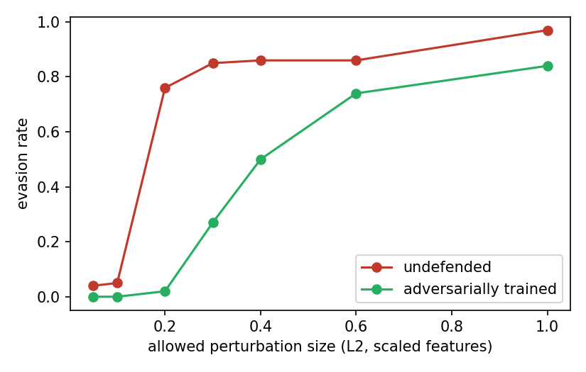

# Black-box evasion attacks on an ML intrusion detector

A small robustness study built on top of the open-source [xai-ids](https://github.com/MohammadThabetHassan/xai-ids) project (credit to its authors, Mohammad Thabet Hassan and contributors). Everything in this study lives in `experiments/robustness_demo.ipynb`; the original project code is unchanged.

## Summary

- A gradient-boosted (XGBoost) detector separates benign from DDoS flows almost perfectly on clean data (accuracy 1.0000, attack recall 0.9999).
- A black-box attacker who can only query the detector can make DDoS flows look benign with **small perturbations**: against the undefended model, about 5% of flows evade at an L2 budget of 0.1, but 76% evade at 0.2.
- **Adversarial training helps but does not solve the problem.** It shifts the curve to the right (2% vs 76% evasion at budget 0.2, 50% vs 86% at 0.4) without hurting clean accuracy, but at budget 1.0 the attacker still evades 84% of flows.

## Question

If an attacker can query an ML-based intrusion detector, how easily can they evade it, and does adversarial training make that harder?

## Method

- **Data:** CIC-IDS-2017, `Friday-WorkingHours-Afternoon-DDos.pcap_ISCX.csv` (benign vs DDoS flows). Infinite/missing rows and duplicate flows were removed (duplicates can leak between train and test).
- **Split:** seeded, stratified 70/30 train/test split.
- **Model:** XGBoost trained on the 20 most important features (importance from a first model fit on all features), after RobustScaler scaling.
- **Threat model:** black-box. The attacker can only query the model's output. Perturbations are limited to the feature ranges seen in training. The attacker starts from DDoS flows the detector currently catches and tries to get them classified as benign.
- **Attack:** HopSkipJump (decision-based, L2) from the Adversarial Robustness Toolbox, on 100 test flows.
- **Defense:** adversarial training. 200 adversarial DDoS flows generated from the training set were added (labelled as attacks) and the model was retrained. The defended model was then attacked again with a fresh attack (an adaptive attacker).
- **Metrics:** clean accuracy, attack recall, and *evasion rate* (share of attacked DDoS flows classified as benign), also as a function of the allowed perturbation size.

## Results

| | Undefended | Adversarially trained |
|---|---|---|
| Clean accuracy | 1.0000 | 1.0000 |
| Attack recall | 0.9999 | 0.9999 |
| Evasion rate (no budget limit) | 1.00 | 1.00 |
| Median perturbation needed (L2, scaled) | 0.141 | 0.405 |

Of the adversarial flows found against the undefended model, only 1% still evaded the retrained model.

Evasion rate when the attacker is limited to a given perturbation size:

| L2 budget | Undefended | Adversarially trained |
|---|---|---|
| 0.05 | 0.04 | 0.00 |
| 0.10 | 0.05 | 0.00 |
| 0.20 | 0.76 | 0.02 |
| 0.30 | 0.85 | 0.27 |
| 0.40 | 0.86 | 0.50 |
| 0.60 | 0.86 | 0.74 |
| 1.00 | 0.97 | 0.84 |

Features the attacker changed most (undefended model, mean change in scaled units): Fwd Packet Length Max (0.171), Destination Port (0.054), Fwd Packet Length Mean (0.041), Bwd Packets/s (0.033), Total Length of Fwd Packets (0.028).

## What this shows

1. **The undefended model has a sharp weak point.** Almost nothing evades at budget 0.1, but most flows evade at 0.2. This is consistent with tree models making hard threshold decisions: once a few features cross a split value, the prediction flips.
2. **Adversarial training raises the attacker's cost.** The median perturbation needed went from about 0.14 to about 0.41, with no drop in clean accuracy. It does not make the model robust to a stronger or larger-budget attacker.
3. **The attack mostly moved packet-size features.** Forward packet length features can plausibly be changed by an attacker (for example by padding). The model's reliance on `Destination Port` is a warning sign: an attacker cannot change the port without changing what they attack, so this may be a dataset shortcut rather than a real attack signature, and I would treat it with suspicion.

## Note on the original project's adversarial test

The original repository has a `--adversarial` option that uses ART's FGSM attack. FGSM needs model gradients, and tree models do not provide them. In my run, calling the repo's `evaluate_adversarial_robustness` on an XGBoost model returned an error ("ART FGSM not supported for this model"), which the repo logs as a warning, and the pipeline then produces no adversarial results for XGBoost(ART rejects the model type, and tree models have no gradients for FGSM to use in any case). In the version I read, `compute_xcs_on_adversarial` is also not called from `run_pipeline.py`, so I could not find code that supports the claim in `RESULTS.md` that XCS drops on adversarial inputs. I did not test XCS itself. This study uses a black-box attack because it works on tree models.

## Limitations

- **Simplified threat model.** Perturbations stay within feature ranges but ignore protocol constraints (integer counts, relationships between features such as duration and packet counts). Some adversarial flows may not be physically realisable, and I did not restrict the attacker to features they can actually control.
- **Easy task.** One day of traffic with two classes. Results may not transfer to other attacks or datasets.
- **Small sample.** 100 attacked flows and one run with one seed, so differences of a few percentage points are within noise.
- **Attack is an approximation.** HopSkipJump gives an upper bound on the true minimum perturbation, so the real attacker could do at least as well.
- **Defense tested against the attack it was trained on.** Other attack families may behave differently.
- **Dataset quality.** CIC-IDS-2017 has documented labelling and duplicate issues; de-duplication is only a partial mitigation.

## Reproduce

1. Put the CIC-IDS-2017 Friday-afternoon DDoS CSV in `data/raw/` (and nothing else).
2. Install `requirements.txt` on Python 3.11.
3. Run `experiments/robustness_demo.ipynb` top to bottom. Results are saved in `results/`.

## Possible follow-ups

- Restrict the attacker to features they can realistically control (packet sizes) and exclude `Destination Port`.
- Test other attack types and the multiclass setting.
- Compare against other defenses and repeat with several seeds.
